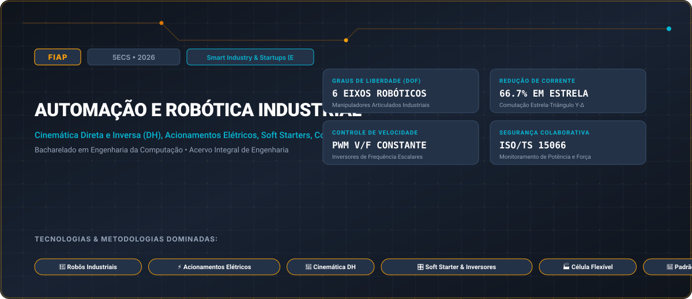

# FIAP • Automação e Robótica Industrial (2026)

> **Engenharia da Computação — FIAP (Faculdade de Informática e Administração Paulista)**  
> **Turma:** 5ECS • Ano Letivo 2026  
> **Desafio Corporativo Integrado:** Smart Industry & Startups (Exoesqueleto Assistivo & Manufatura)  
> **Portal Interativo GitHub Pages:** [https://guimemee.github.io/fiap-automacao-e-robotica/](https://guimemee.github.io/fiap-automacao-e-robotica/)

---

## 📋 Sumário Executivo do Acervo

Este repositório consolida o acervo acadêmico integral e os projetos práticos de engenharia da disciplina **Automação e Robótica Industrial**, contemplando:
1. **6 Checkpoints Oficiais (2026):** Enunciados integrais originais, memórias de cálculo passo a passo no padrão Symbolab e cadernos Jupyter (`.ipynb`) com gráficos executáveis.
2. **01_Apostilas_e_Teoria:** Livros didáticos, apostilas e slides de aulas.
3. **02_Exercicios_e_Laboratorios:** Listas práticas, scripts e códigos de laboratório.
4. **04_Global_Solution:** Desafios integradores semestrais da FIAP.
5. **05_Challenge_Sprints:** Sprints interdisciplinares de inovação corporativa (Smart Industry & Startups (Exoesqueleto Assistivo & Manufatura)).

---

## 🎯 6 Checkpoints Oficiais (2026)

- **Checkpoint 1:** Partida de Motores, Diagramas de Potência e Comandos Elétricos Industriais &rarr; [`03_Provas_Avaliativas_Checkpoints/Checkpoint_1_cp1/Resolucao_Calculos.ipynb`](03_Provas_Avaliativas_Checkpoints/Checkpoint_1_cp1/Resolucao_Calculos.ipynb)
- **Checkpoint 2:** Cinemática de Manipuladores Robóticos e Parâmetros Denavit-Hartenberg (DH) &rarr; [`03_Provas_Avaliativas_Checkpoints/Checkpoint_2_cp2/Resolucao_Calculos.ipynb`](03_Provas_Avaliativas_Checkpoints/Checkpoint_2_cp2/Resolucao_Calculos.ipynb)
- **Checkpoint 3:** Acionamento Eletrônico com Soft-Starters e Inversores de Frequência &rarr; [`03_Provas_Avaliativas_Checkpoints/Checkpoint_3_cp3/Resolucao_Calculos.ipynb`](03_Provas_Avaliativas_Checkpoints/Checkpoint_3_cp3/Resolucao_Calculos.ipynb)
- **Checkpoint 4:** Análise Técnico-Econômica de Automação e Custo Operacional Homem vs. Robô &rarr; [`03_Provas_Avaliativas_Checkpoints/Checkpoint_4_cp4/Resolucao_Calculos.ipynb`](03_Provas_Avaliativas_Checkpoints/Checkpoint_4_cp4/Resolucao_Calculos.ipynb)
- **Checkpoint 5:** Planejamento de Trajetórias no Espaço das Juntas e Cartesiano &rarr; [`03_Provas_Avaliativas_Checkpoints/Checkpoint_5_cp5/Resolucao_Calculos.ipynb`](03_Provas_Avaliativas_Checkpoints/Checkpoint_5_cp5/Resolucao_Calculos.ipynb)
- **Checkpoint 6:** Robótica Colaborativa, Células Flexíveis e Segurança ISO/TS 15066 &rarr; [`03_Provas_Avaliativas_Checkpoints/Checkpoint_6_cp6/Resolucao_Calculos.ipynb`](03_Provas_Avaliativas_Checkpoints/Checkpoint_6_cp6/Resolucao_Calculos.ipynb)

---

## 🏛️ Créditos e Rastreabilidade
- **Instituição:** FIAP (Faculdade de Informática e Administração Paulista)
- **Curso:** Bacharelado em Engenharia da Computação
- **Turma:** 5ECS • Ano Letivo 2026
- **Aluno:** Guilherme Macário da Silva ([@Guimemee](https://github.com/Guimemee))
